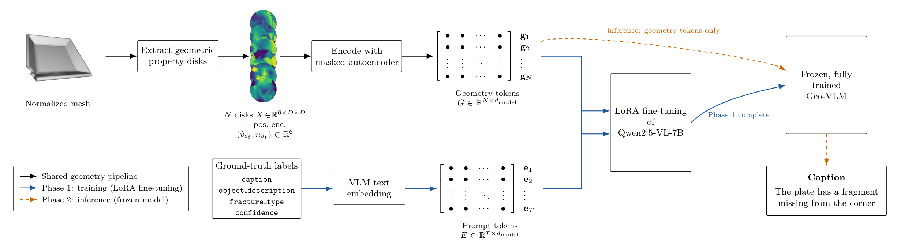
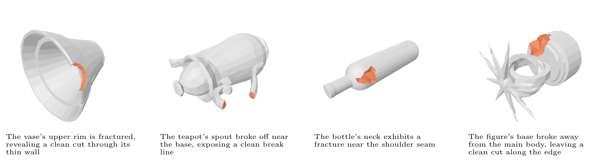
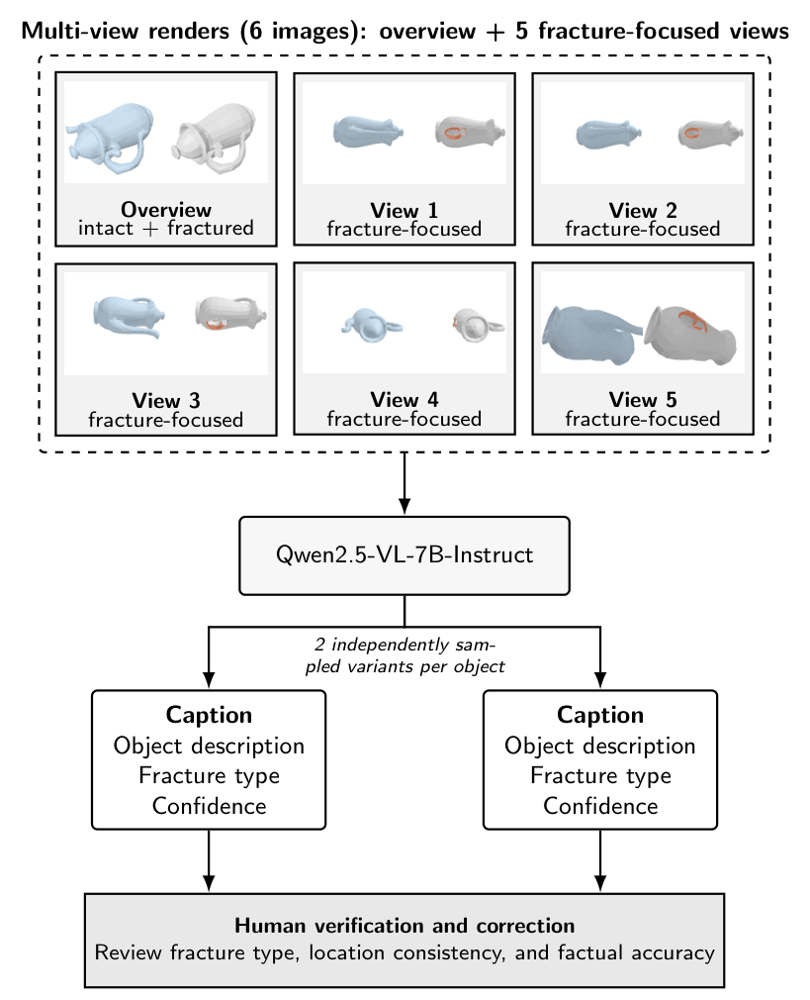

# 3D Fracture Captioning with Tangent-Plane Curvature Disks and Vision-Language Models

Class-blind captioning of fractured 3D objects directly from surface geometry. Principal curvature is estimated at farthest-point-sampled locations, encoded as tangent-plane curvature disks, compressed by an MAE-style GeometryProjector into a geometry prefix, and injected into Qwen2.5-VL-7B-Instruct (LoRA). The object class is withheld from the prompt so captions must be grounded in geometry.

Paper: *3D Fracture Captioning with Tangent-Plane Curvature Disks and Vision-Language Models* (manuscript in preparation).

 
## Overview
 
**Method pipeline**
 


 
 
**Results**
 


## Repository structure

```
.
├── README.md
├── requirements.txt
├── .gitignore
├── configs/
│   └── train_configs.yaml            # training hyperparameters
├── data/
│   └── captions/
│       └── captions.csv              # human-verified fracture captions
├── scripts/
│   ├── BreakingBadDataset.py         # mesh -> curvature -> FPS -> tangent-disk tensors
│   ├── caption_fractures.py          # stage 1: multi-image VLM captioning
│   ├── train_mae.py                  # stage 2: MAE projector + LoRA training
│   └── infer_mae.py                  # inference on one OBJ or a CSV batch
├── tools/
│   ├── render_views/
│   │   ├── render_multiview.py       # render overview + fracture-hemisphere views (frac and base)
│   │   └── make_pair_images.py       # stitch base|frac renders, write pairs.csv
│   ├── cache_data/
│   │   ├── cache_dataset.py          # precompute geometry .pt caches
│   │   └── check_cache.py            # sanity-check the caches
│   └── verify_captions/
│       └── caption_evaluator.ipynb   # human verification / correction of captions
├── evaluation/
│   └── caption_evaluation.ipynb      # CLIP metrics, collapse diagnostics, CIDEr-R
└── legacy/
    ├── train_mae_image_only.py       # image-only baseline (training)
    └── infer_mae_image_only.py       # image-only baseline (inference)
```

## Installation

```bash
pip install -r requirements.txt
```

Main dependencies: `torch`, `transformers`, `peft`, `bitsandbytes`, `qwen-vl-utils`, `open3d`, `trimesh`, `pyrender`, `pillow`, `scipy`, `pandas`, `numpy`. Optional: `wandb`, `flash-attn`.

## Data

1. Download the [Breaking Bad dataset](https://breaking-bad-dataset.github.io/) and note its root folder.
2. `data/captions/captions.csv` holds the verified captions. Each row has `path` (OBJ path relative to the dataset root), `class`, `object_description`, `fracture_type`, `confidence`, `caption`, and `parse_error`.

## Pipeline

Run all commands from the repository root. The scripts import `BreakingBadDataset` from their own folder, so do not move it out of `scripts/`.

### 0. Render multi-view images

```bash
python tools/render_views/render_multiview.py meshes.csv --views 6 --size 512
```

The CSV needs `path` (fractured piece `.obj`) and `base_path` (complete base `.obj`). A `<stem>_labels.txt` with one integer per face (0 = normal, 1 = fracture) must sit next to each `path` file. For each pair the script writes one overview image and `views-1` cameras spread over the hemisphere facing the fracture, for both the fractured piece (`*_frac_view_*.png`) and the base (`*_base_view_*.png`), next to the fractured `.obj`. Set `PYOPENGL_PLATFORM=egl` on headless servers.

Then stitch each base/fractured pair side by side (intact on the left, fractured on the right) and build the CSV that stage 1 reads:

```bash
python tools/render_views/make_pair_images.py meshes.csv --out pairs.csv
```

This writes `<stem>_pair_view_overview.png` and `<stem>_pair_view_frac00.png` onward, and `pairs.csv` with `path`, `class` (copied from `meshes.csv` if present, else `unknown`), and `pair_images_path`.

### 1. Stage 1: generate candidate captions
 
**Stage 1: multi-image VLM captioning**
 


```bash
python scripts/caption_fractures.py --csv pairs.csv --output captions_raw.csv --n_captions 2
```

The input CSV needs `path`, `class`, and `pair_images_path`. Candidates are then checked and corrected with `tools/verify_captions/caption_evaluator.ipynb`.

### 2. Precompute geometry caches (recommended)

```bash
python tools/cache_data/cache_dataset.py
python tools/cache_data/check_cache.py
```

Caches are written next to each OBJ, with the configuration encoded in the filename. Use the same `n_fps`, `disk_grid`, and `disk_radius_frac` as training.

### 3. Train

```bash
python scripts/train_mae.py \
    --csv data/captions/captions.csv --root /path/to/breaking_bad --out ./checkpoints \
    --n_fps 1024 --disk_grid 32 --curv_channels 6 \
    --proj_hidden 256 --mae_enc_layers 4 --mae_mask_ratio 0.5 --mae_lam 0.2 --mae_chunk_size 32 \
    --max_geo_tokens 512 --max_seq_len 512 \
    --lora_r 32 --lora_target_modules q_proj k_proj v_proj o_proj gate_proj up_proj down_proj \
    --batch 2 --grad_accum 8 --epochs 5 --freeze_lm_steps 2000 \
    --proj_lr 1e-3 --warmup_ratio 0.1 --load_4bit \
    --wandb test_drive --log_steps 20 --save_steps 1000 --dataloader_workers 2
```

The same values are stored in `configs/train_configs.yaml`. Note that `train_mae.py` does not read the YAML file directly yet, so pass the values as flags.

Resume with `--resume checkpoints/ckpt_step1000`.

### 4. Inference

Inference hyperparameters must match training.

```bash
# single mesh
python scripts/infer_mae.py --ckpt checkpoints/ckpt_best --obj path/to/fragment.obj \
    --n_fps 1024 --disk_grid 32 --curv_channels 6 --proj_hidden 256 --max_geo_tokens 512

# batch
python scripts/infer_mae.py --ckpt checkpoints/ckpt_best --csv test.csv --root /path/to/breaking_bad \
    --out predictions.csv --n_fps 1024 --disk_grid 32 --curv_channels 6 --proj_hidden 256 --max_geo_tokens 512
```

### 5. Evaluation

Open `evaluation/caption_evaluation.ipynb` to compute CLIPScore, RefCLIPScore, CLIP R-Precision, and the collapse diagnostics (unique caption count, per-class top-1 share, exact-duplicate rate, CIDEr-R with paired bootstrap).

## Notes

- A 4-bit base model (`--load_4bit`) keeps the 7B model within a single consumer GPU. Lower `--mae_chunk_size` if you run out of memory.
- Changing `n_fps`, `disk_grid`, or `curv_channels` between runs requires matching caches and a matching projector at inference.
- `legacy/` holds the image-only baselines and is not needed to reproduce the main results. These scripts import `BreakingBadDataset` from `scripts/`, so run them with `scripts/` on `PYTHONPATH` or copy the dataset file next to them.

## Citation

TBD

## License

TBD.